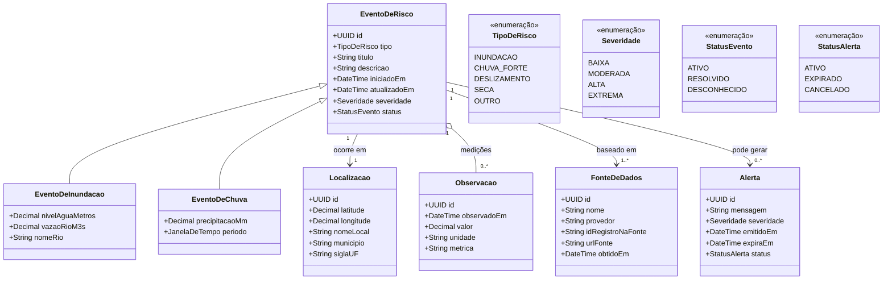
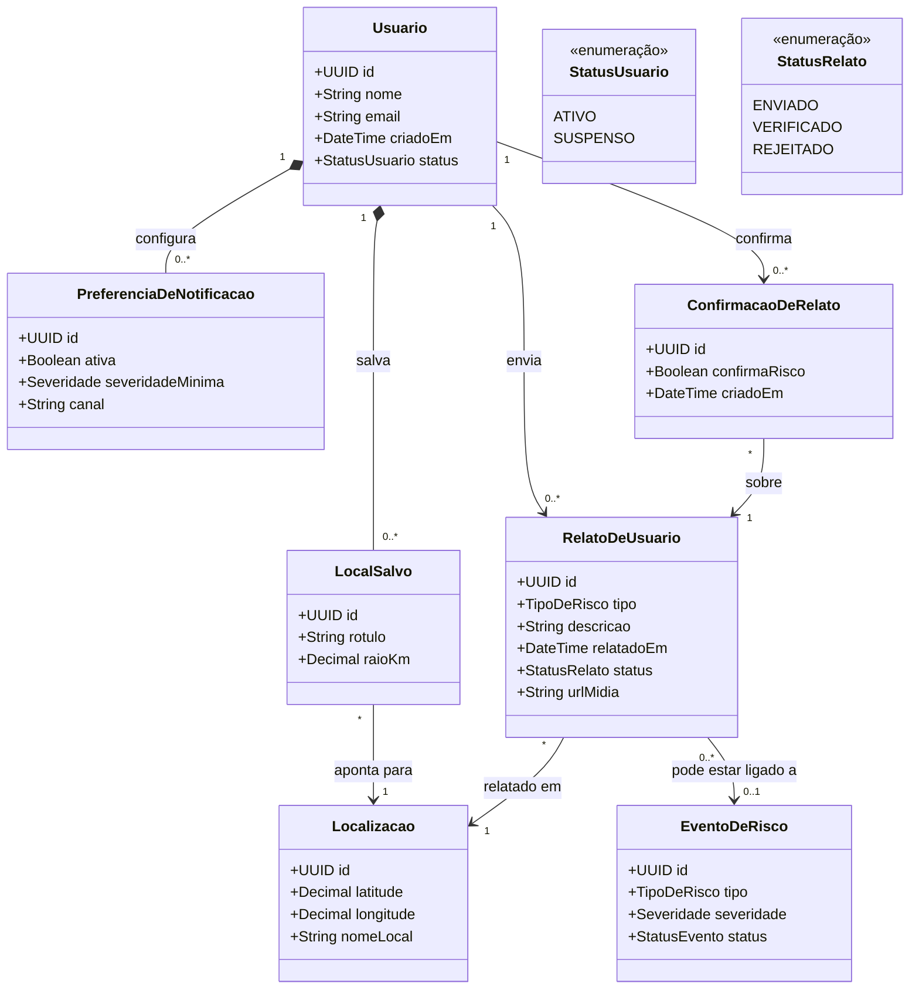
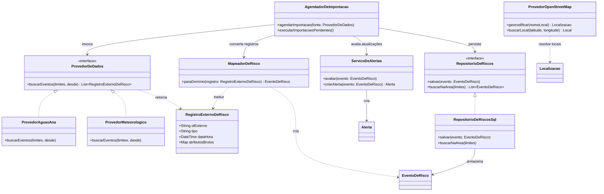

# Rastreador de Desastres Naturais — opções de diagrama de classes UML

O repositório ainda é apenas a estrutura inicial da aplicação, então estes diagramas descrevem um modelo de domínio proposto, e não uma implementação existente. Eles assumem que **ANA** é a *Agência Nacional de Águas e Saneamento Básico*. Adaptadores específicos de cada API mantêm o domínio independente da ANA, do OpenStreetMap e de qualquer provedor de dados meteorológicos.

## 1. Domínio principal — sem contas de usuário

Use esta opção quando a primeira versão apenas importa e exibe dados públicos de riscos.

## 2. Com usuários e relatos da comunidade

Acrescente esta parte se as pessoas puderem se cadastrar, salvar locais, receber alertas ou enviar/confirmar relatos. O relato de um usuário fica separado de uma medição oficial para que a origem e a confiabilidade continuem claras.

## 3. Aplicação e integração com APIs externas

Use esta visão de projeto para o backend. O agendador solicita as importações; os adaptadores de cada provedor traduzem os dados externos para o modelo principal. O OpenStreetMap é modelado como provedor de geocodificação e dados de mapa, não como fonte de medições de risco.

## Ponto de partida sugerido

Para uma primeira entrega de diagrama de classes, combine o diagrama 1 com as fronteiras de integração do diagrama 3. Inclua o diagrama 2 apenas se contas de usuário ou relatos da comunidade fizerem parte dos requisitos planejados. Mantenha `EventoDeRisco` genérico e crie subclasses apenas para riscos com dados realmente diferentes; leituras de chuva, por exemplo, podem ser observações em vez de eventos independentes, dependendo da API.

### Notas de modelagem

- Guarde o provedor e o identificador do registro no provedor para os dados importados, de modo que os registros possam ser rastreados e não sejam duplicados.
- Guarde as datas e horas em um fuso horário consistente (normalmente UTC) e mantenha também a data/hora informada pela fonte.
- Trate a severidade como uma classificação normalizada da aplicação; mantenha os valores originais do provedor no registro importado ou na observação quando necessário.
- Para os dados da ANA, confirme quais conjuntos de dados e campos estão disponíveis antes de fixar `nivelAguaMetros`, `vazaoRioM3s` ou a frequência de atualização como requisitos.
