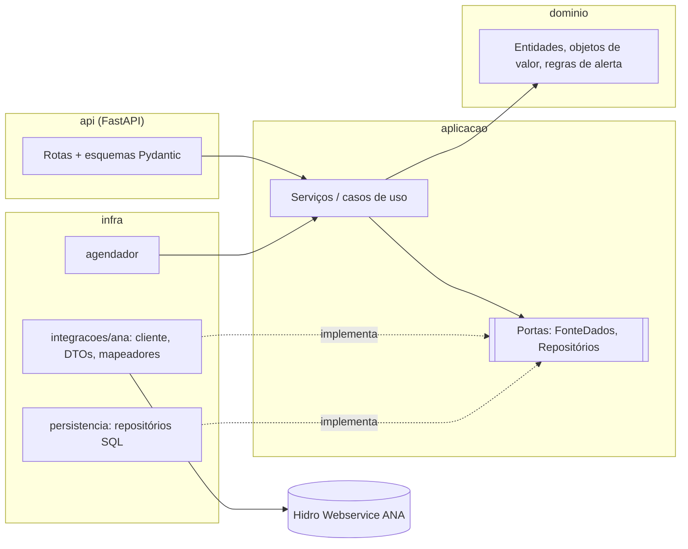
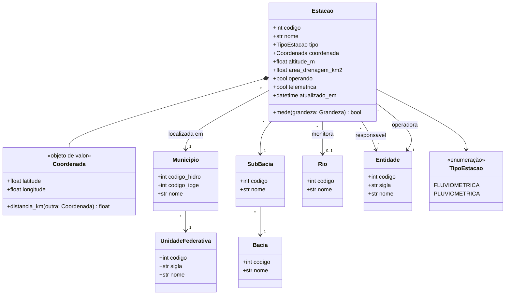
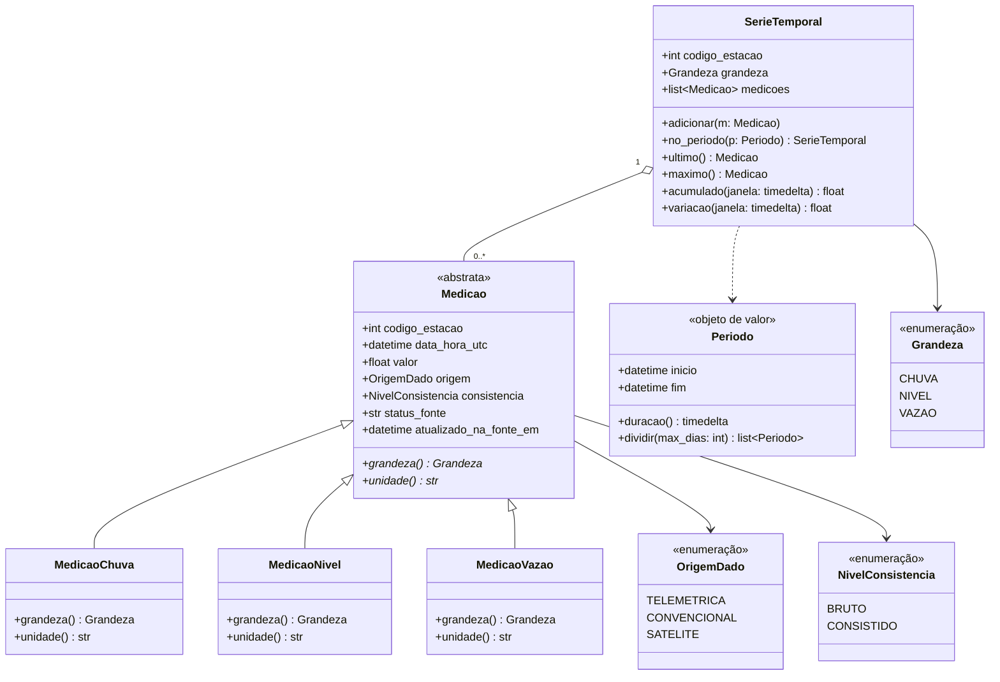
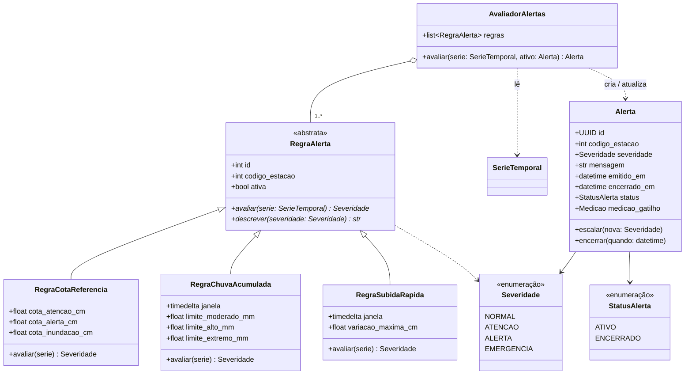
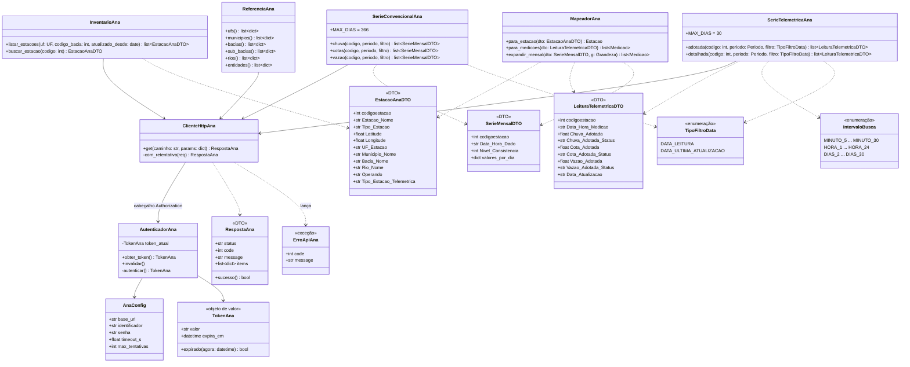
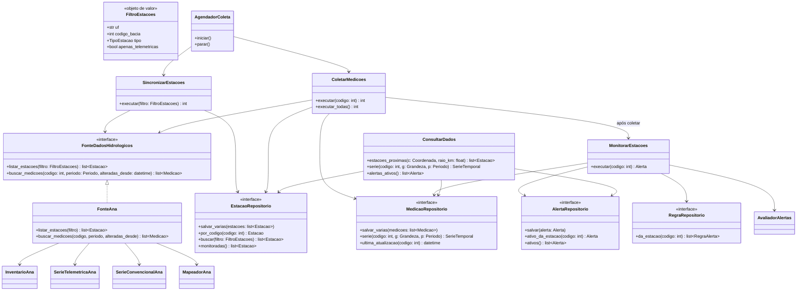
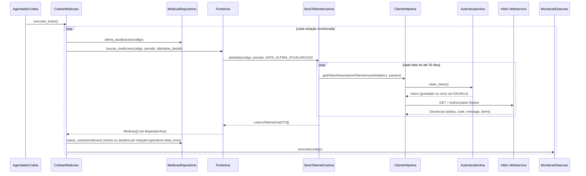

# TaPoo — Diagramas de classe (integração com a API da ANA)

Guia para a criação das classes e da arquitetura do backend. Os diagramas são
uma **proposta** — o código atual ainda é só a estrutura inicial (`backend/app/main.py`).

Fonte: OpenAPI oficial do **Hidro Webservice** da ANA
(`https://www.ana.gov.br/hidrowebservice`, versão `v1.0.3984.2`, consultada em 2026-11-11).

## 0. O que a API da ANA oferece (resumo que guia o modelo)

| Grupo | Endpoint (`/EstacoesTelemetricas/...`) | Filtros principais | Limite por requisição |
|---|---|---|---|
| Autenticação | `OAUth/v1` | headers `Identificador`, `Senha` → token | — |
| Inventário | `HidroInventarioEstacoes/v1` | código da estação **ou** código da bacia **ou** UF | ao menos 1 filtro |
| Telemétricas | `HidroinfoanaSerieTelemetricaAdotada/v1`, `...Detalhada/v1` | código, `Tipo Filtro Data`, `Data de Busca`, `Range Intervalo de busca` | **30 dias** |
| Convencionais | `HidroSerieChuva`, `HidroSerieCotas`, `HidroSerieVazao`, `HidroSerieCurvaDescarga`, `HidroSerieResumoDescarga`, `HidroSeriePerfilTransversal`, `HidroSerieQA`, `HidroSerieSedimentos`, `HidroSerieGranulometria` | código, `Tipo Filtro Data`, data inicial/final | **366 dias** |
| Satélite | `HidrosatInventarioEstacoes/v1`, `HidrosatSerieDados/v1` | código, período | 366 dias |
| Referência | `HidroUF`, `HidroMunicipio`, `HidroBacia`, `HidroSubBacia`, `HidroRio`, `HidroEntidade` | código, data de atualização | sem limite |

Pontos que **influenciam o design**:

- Todo endpoint é `GET` e devolve o mesmo envelope `Devolucao { status, code, message, items }`
  → um único cliente HTTP genérico + leitores (parsers) por endpoint.
- Os endpoints de dados exigem token → componente de autenticação que guarda o token em memória e o renova.
- Os limites de 30/366 dias por requisição → o cliente precisa **fatiar períodos** automaticamente.
- `Tipo Filtro Data` = `DATA_LEITURA | DATA_ULTIMA_ATUALIZACAO` → permite **sincronização
  incremental** (buscar só o que mudou desde a última coleta).
- O código de município da base Hidro **não é o do IBGE** → guardar os dois códigos separadamente.
- O OpenAPI não tipa o conteúdo de `items`. Os nomes de campo dos DTOs abaixo
  (`codigoestacao`, `Cota_Adotada`, ...) seguem o formato que a API costuma devolver, mas
  **precisam ser conferidos com uma resposta real autenticada** antes de implementar a leitura das respostas.

## 1. Visão de camadas (arquitetura)



Regra de dependência: `dominio` não importa nada das outras camadas; a ANA é apenas
**um adaptador** de `FonteDadosHidrologicos`. Isso permite trocar/adicionar outras fontes
(ex.: CEMADEN, INMET) e testar os serviços com implementações falsas (fakes).

Estrutura de pacotes sugerida:

```
backend/app/
  dominio/        estacao.py, medicao.py, geografia.py, alerta.py, enums.py
  aplicacao/      portas.py, sincronizacao.py, coleta.py, monitoramento.py, consulta.py
  infra/
    integracoes/ana/  config.py, autenticacao.py, cliente.py, endpoints.py, dtos.py, mapeadores.py, periodo.py
    persistencia/     repositorios_sql.py, modelos_orm.py
    agendador.py
  api/            routers/estacoes.py, routers/medicoes.py, routers/alertas.py, schemas.py
  main.py
```

## 2. Domínio — estações e geografia

Espelha o inventário e as tabelas de referência da ANA, mas com nomes e tipos próprios.



## 3. Domínio — medições e séries temporais

As séries telemétricas (adotada) trazem chuva, nível e vazão na mesma linha; as convencionais
vêm em endpoints separados. O domínio normaliza tudo em **uma medição por grandeza**.



> `Periodo.dividir()` é reaproveitado pelo cliente ANA para respeitar os limites de 30/366 dias.

## 4. Domínio — monitoramento e alertas

A ANA **não** fornece cotas de alerta/inundação nem severidade: isso é regra do TaPoo,
configurada por estação. As regras usam o padrão **Strategy**.



## 5. Infra — cliente da API da ANA (adaptador)



Notas de implementação:

- `ClienteHttpAna` recebe `401` → chama `AutenticadorAna.invalidar()` e tenta uma vez de novo.
- `SerieTelemetricaAna` / `SerieConvencionalAna` usam `Periodo.dividir(MAX_DIAS)` e concatenam
  os resultados; nunca expõem o limite a quem chama.
- `LeituraTelemetricaDTO` vira até **três** `Medicao` (chuva, nível, vazão), ignorando valores nulos.
- `SerieMensalDTO` (convencionais) chega como uma linha por mês com colunas por dia
  (`Chuva_01`…`Chuva_31`, `Cota_01`…) → `expandir_mensal` gera uma `Medicao` por dia.
- Converter `Data_Hora_Medicao` (horário local da fonte) para UTC no mapeador.
- Credenciais (`Identificador`/`Senha`) vêm de variáveis de ambiente, nunca do código.

## 6. Aplicação — portas, serviços e adaptadores



Os repositórios SQL (`EstacaoRepositorioSql`, etc.) implementam as interfaces acima na camada
`infra/persistencia`; as rotas FastAPI dependem apenas dos serviços (via `Depends`).

## 7. Fluxo de coleta incremental (sequência)



## Decisões de modelagem

- **Inserir ou atualizar (upsert) pela chave natural** `(codigo_estacao, grandeza, data_hora_utc, origem)`: a ANA reenvia
  dados quando são corrigidos; a coleta incremental por `DATA_ULTIMA_ATUALIZACAO` depende disso.
- **Guardar o status/consistência da fonte** em `Medicao` — dados brutos telemétricos podem ser
  revisados depois; alertas devem saber se se basearam em dado bruto.
- **Começar pelas telemétricas** (adotada): são as únicas próximas do tempo real e servem para
  alertas. Convencionais servem para histórico/estatística e podem ficar para uma segunda fase.
- **HidroSat, qualidade da água, sedimentos, perfil transversal, curva de descarga** ficam fora do
  modelo inicial; adicioná-los é criar um novo método no adaptador + nova subclasse de `Medicao`
  se for uma grandeza nova.
- **Usuários/relatos da comunidade** (ver `docs/class-diagrams.md`, diagrama 2) são independentes
  da ANA e podem ser acoplados depois via `Estacao`/`Coordenada`.
